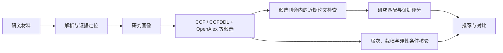

# Super Scholar｜科研成果理解与计算机领域投稿推荐

> 从研究材料出发，整理有证据的研究画像，结合候选会议、期刊的近期论文与投稿条件，帮助研究者比较并选择目标刊会。

Super Scholar 是一个本地优先的计算机领域科研辅助应用。它把“看懂材料”和“推荐投稿去向”连成一条可检查的路径：

```text
首页 → 工作区 → 项目 → 上传材料 → 研究画像 → 投稿偏好
     → 推荐刊会 → 对比依据 → 选择目标
```

项目希望回答两个不同的问题：**研究内容与刊会是否匹配？当前是否具备可核实的投稿条件？** 匹配分数不是录用概率；截止日期、版面费、分区等字段缺少可靠来源时显示未核验，不用猜测值填空。

## 主要能力

| 阶段 | 实现 |
| --- | --- |
| 材料理解 | 解析 PDF、DOCX、LaTeX、源码 ZIP、表格和图片；保留文字、表格、代码与视觉证据的来源位置 |
| 研究画像 | 先生成本地基线；用户可选择模型深度分析，输出可回查到材料的研究问题、方法与贡献 |
| 候选发现 | 结合 CCF / CCFDDL、OpenAlex 相关论文与 Source、Semantic Scholar、DBLP、Crossref |
| 推荐与对比 | 以候选刊会近期相关论文为核心衡量研究匹配，并单独核验当前届次、截稿和限制条件 |
| 证据浏览 | 推荐卡片可展开实际返回的相关论文；论文页、图表、代码和表格证据可以回到原始材料 |

模型提供理解与归纳，**来源身份、引用和硬性条件仍由可核验数据约束**。OpenAlex 的 `2yr_mean_citedness` 不冒充 JIF；JCR 分区、JIF 和 WoS 收录只有在具备有效 Clarivate 授权并成功核验后展示。APC 只有来源给出公开价格时才换算，汇率日期与来源随结果保存。没有统一可靠的审稿周期来源时，系统显示未核验。

## 推荐链路



候选身份先经过 ISSN、规范名称和别名核对；短缩写如 FAST、CASE、DATE、CHI 只有出现在参考文献或刊会上下文时才作为线索。会议系列会审慎合并近期年度论文集，排除 workshop、companion 等旁支。缺失信号不等同于零分，实际评分只使用可得证据并重新归一化；未能核实的 Required 条件不能被当成已满足。

当前研究匹配的名义权重为：候选刊会内近期论文 **48%**、OpenAlex 全局直接发表证据 **14%**、计算机子领域 **18%**、Semantic Scholar **8%**、参考文献 **8%**、Source 主题 **4%**。这是证据适配度，不是中稿概率。当前可投列表只收录已核实开放且通过必要条件的会议届次。

## 材料与模型如何协作

本地解析先生成可用的研究画像，不调用外部模型。用户主动发起深度分析后，流程把文字和视觉内容分开处理：文本分段提取事实，图片一次一张交给支持视觉的模型，最后用简短事实合成研究画像，并校验所有证据 ID。正常流程不会把原始 PDF 整份上传到模型服务。

OpenAI、DeepSeek 和自定义兼容服务分别保存配置；切换服务商不会覆盖其他配置。DeepSeek 按文本模型处理，扫描件需要先经本地 OCR；自定义服务必须明确设置协议、结构化输出、流式和视觉能力，不因“兼容 OpenAI”就假定全部可用。SDK 自动重试关闭，失败不会隐式重复发送付费请求。视觉失败不丢弃已成功的文本事实；最终合成失败时保留已提取结果，生成可追溯的部分画像。

外部学术来源各有独立的诊断结果：`Ready`、`Limited`、`Degraded`。诊断区分 OpenAlex Works 搜索与候选 Source 解析；匿名接口遇到限流时会明确显示受限，不把“连通”误报为完整可用。密钥由应用加密保存，浏览器只接收遮罩提示。

## 使用 Docker 启动

在仓库根目录准备 Docker Desktop，然后运行：

```powershell
docker compose up -d --build --wait
```

打开 **http://127.0.0.1:3000**。后端健康检查位于 **http://127.0.0.1:8000/health**。数据库、持久化、配置方式与限制见 [Docker 部署指南](DOCKER_DEPLOY.md)。模型和学术来源密钥需要使用自己的账号配置；不要把 `.env`、数据库、密钥文件或上传材料提交到 GitHub。

### 从源码启动

后端需要 Python 和 Node.js 20+。在 PowerShell 中分别运行：

```powershell
cd backend
python -m venv .venv
.venv\Scripts\Activate.ps1
Copy-Item .env.example .env
pip install -e ".[dev]"
alembic upgrade head
uvicorn app.main:app --reload --host 127.0.0.1 --port 8000
```

另开终端启动前端：

```powershell
cd frontend
Copy-Item .env.example .env.local
npm install
npm run dev
```

前端位于 **http://127.0.0.1:3000**，后端接口文档位于 **http://127.0.0.1:8000/docs**。请在各自目录执行命令；如需 Linux/macOS 路径与升级说明，参见 [Docker 部署指南](DOCKER_DEPLOY.md)及 [版本记录](V3.9_NOTES.md)。

## 版本脉络

- **V3.11：** 补充 OpenAlex 期刊开放获取、APC 与引用统计；可选 Clarivate 核验 WoS/JCR/JIF；证据列表可展开全部实际返回论文。
- **V3.10：** 推荐重点转向候选刊会内近期论文，并把学术匹配与当前投稿可行性分开展示。
- **V3.9.1：** 候选 OpenAlex Source 身份解析和多模型服务商配置独立持久化。
- **V3.9：** OpenAlex、Semantic Scholar、DBLP、Crossref、CCF/CCFDDL 的连接诊断、身份补全与缺失证据语义。
- **V3.8：** 引入多证据混合召回和评分，避免单条相关论文把匹配分推成满分。
- **V3.7：** 建立计算机领域刊会候选、偏好筛选与对比流程；图表证据改为按标题定位的裁切，界面可回查来源。

升级现有安装前，要一起备份 `backend/data/super_scholar.db`、`backend/data/.credential_key` 与 `backend/storage/`。缺少原密钥就无法解密之前在设置页保存的 API 密钥。升级后运行 `pip install -e ".[dev]"` 和 `alembic upgrade head`。不要用空配置覆盖已有文件。

## 验证与边界

此仓库提供后端测试与数据库迁移；Docker 方案已在本机完成镜像构建、容器健康检查、前后端 HTTP 访问和 SQLite 表初始化验证。推荐质量取决于材料解析、外部来源及模型可用性；缺少授权数据时不会伪造 JIF、APC、审稿时长或当前开放状态。当前作品聚焦**计算机领域的投稿选择**，不代替人工阅读投稿须知和期刊官网。

本仓库尚未附项目级 LICENSE；公开可读不等于已授予复制或再分发许可。

