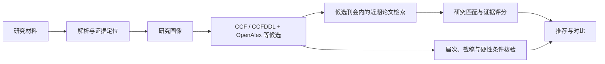

# Super Scholar｜科研理解与投稿推荐 Agent

读取研究材料，提取有出处的研究事实，调用学术检索工具查找相关论文与刊会，再按投稿要求筛选和比较。

[English / 原版完整技术记录](README.en.md) · [Docker 部署](DOCKER_DEPLOY.md) · [版本记录](V3.9_NOTES.md)

本项目采用分阶段的 Agent 工作流：模型负责从材料中提取事实、合成研究画像；检索工具与推荐管线负责候选身份、证据和投稿约束核验。每条推荐都应能说明：为什么相关、依据来自哪里、哪些条件还没有核实。

Super Scholar 是一个本地优先的计算机领域科研辅助应用。它把“看懂材料”和“推荐投稿去向”连成一条可检查的路径：

```text
首页 → 工作区 → 项目 → 上传材料 → 研究画像 → 投稿偏好
     → 推荐刊会 → 对比依据 → 选择目标
```

项目希望回答两个不同的问题：**研究内容与刊会是否匹配？当前是否具备可核实的投稿条件？** 匹配分数不是录用概率；截止日期、版面费、分区等字段缺少可靠来源时显示未核验，不用猜测值填空。

## 为什么需要科研 Agent

从一篇论文里提取几个关键词，还不足以判断投向。系统需要理解研究问题、方法和实验，再查候选刊会近期发表的相关工作，核对截稿、领域、费用等条件。材料解析、模型输出和外部数据都可能不完整，因此每一步都要保留来源，并说明缺少的证据。

用户上传论文及相关材料后，可以先查看本地生成的研究画像，再主动发起模型分析。得到画像后，设置投稿要求，查看候选推荐、相关论文与条件核验结果，最后比较和选择目标刊会。

## 可以体验什么

| 阶段 | 实现 |
| --- | --- |
| 材料理解 | 解析 PDF、DOCX、LaTeX、源码 ZIP、表格和图片；保留文字、表格、代码与视觉证据的来源位置 |
| 研究画像 | 先生成本地基线；用户可选择模型深度分析，输出可回查到材料的研究问题、方法与贡献 |
| 候选发现 | 结合 CCF / CCFDDL、OpenAlex 相关论文与 Source、Semantic Scholar、DBLP、Crossref |
| 推荐与对比 | 以候选刊会近期相关论文为核心衡量研究匹配，并单独核验当前届次、截稿和限制条件 |
| 证据浏览 | 推荐卡片可展开实际返回的相关论文；论文页、图表、代码和表格证据可以回到原始材料 |

模型提供理解与归纳，**来源身份、引用和硬性条件仍由可核验数据约束**。OpenAlex 的 `2yr_mean_citedness` 不冒充 JIF；JCR 分区、JIF 和 WoS 收录只有在具备有效 Clarivate 授权并成功核验后展示。APC 只有来源给出公开价格时才换算，汇率日期与来源随结果保存。没有统一可靠的审稿周期来源时，系统显示未核验。

## Agent 架构与推荐链路



候选身份先经过 ISSN、规范名称和别名核对；短缩写如 FAST、CASE、DATE、CHI 只有出现在参考文献或刊会上下文时才作为线索。会议系列会审慎合并近期年度论文集，排除 workshop、companion 等旁支。缺失信号不等同于零分，实际评分只使用可得证据并重新归一化；未能核实的 Required 条件不能被当成已满足。

当前研究匹配的名义权重为：候选刊会内近期论文 **48%**、OpenAlex 全局直接发表证据 **14%**、计算机子领域 **18%**、Semantic Scholar **8%**、参考文献 **8%**、Source 主题 **4%**。这是证据适配度，不是中稿概率。当前可投列表只收录已核实开放且通过必要条件的会议届次。

### 候选发现与身份核验

CCF / CCFDDL 提供目录和届次信息；没有强制 CCF 限制时，也允许从 OpenAlex 相关论文中发现额外候选。期刊优先通过 ISSN 解析 Source，会议通过规范名称、别名与年度论文集确认身份。

参考文献先验只从 References / Bibliography 提取，排除论文首页的会议水印。普通单词或“用了几个 agent”这样的实现描述，不能直接变成某个研究社区的证据。CCF 在当前版本用于偏好筛选，不进入 Research Match。

### 学术工具与外部来源

| 工具 / 来源 | 在流程中的职责 |
| --- | --- |
| OpenAlex | 相关论文搜索、候选 Source 解析、刊会内近期论文检索，以及公开期刊元数据 |
| Semantic Scholar | 独立的相关论文与发表刊会证据 |
| DBLP | 计算机领域刊会名称与身份规范化 |
| Crossref | DOI、ISSN、出版商与期刊身份核验 |
| CCF / CCFDDL | 目录、会议届次、截稿与偏好元数据 |
| Clarivate（可选） | 有效授权下核验 WoS、JCR 分区与 JIF |
| ECB | 公开 APC 换算所需的汇率，连同日期和来源保存 |

每次推荐保存各来源的健康状态，区分已查无结果、身份未核实、限流和请求失败。Source 解析失败不等于该刊会没有相关论文；Required 条件无法核实就不能通过，Preferred 缺失保持中性。

### 证据怎样回到原材料

PDF 使用 PyMuPDF 页面几何与标题位置重建 Figure / Table 裁切，整页渲染用于导航与回退。证据保留稳定 ID 供模型输出校验，页面展示“论文 · p.5”“代码 · models/model.py”等可读位置，点击可以打开原页或图表。

推荐卡片默认显示前 5 篇相关论文，可展开本次实际返回并保存的全部论文。研究结论、材料证据与推荐证据各自保留出处。

## 技术栈与代码入口

| 层 | 技术 | 主要入口 |
| --- | --- | --- |
| 前端工作台 | Next.js 16、React 19、TypeScript、Tailwind CSS、Motion、Zustand | [frontend](frontend) |
| API 与数据校验 | FastAPI、Pydantic、HTTPX | [main.py](backend/app/main.py)、[routers](backend/app/routers) |
| 研究理解流程 | Python 分阶段提取与合成、OpenAI SDK、多服务商适配 | [research_analysis.py](backend/app/services/research_analysis.py)、[research_ai.py](backend/app/services/research_ai.py)、[research_provider.py](backend/app/services/research_provider.py) |
| 文档与视觉证据 | PyMuPDF、python-docx、openpyxl、Pillow、可选 Tesseract OCR | [research_documents.py](backend/app/services/research_documents.py) |
| 学术检索与推荐 | 多来源 HTTP 工具、候选身份核验、证据评分与约束筛选 | [venue_recommendation.py](backend/app/services/venue_recommendation.py)、[venue_intelligence.py](backend/app/services/venue_intelligence.py)、[openalex.py](backend/app/services/openalex.py) |
| 持久化与配置 | SQLite、SQLAlchemy、Alembic、cryptography | [models.py](backend/app/models.py)、[db.py](backend/app/db.py)、[security.py](backend/app/security.py) |
| 部署与验证 | Docker Compose、Uvicorn、pytest、TypeScript 检查 | [compose.yaml](compose.yaml)、[backend/tests](backend/tests) |

Agent 流程由项目的 Python 服务组织，重点在材料证据、工具结果和生成过程的衔接；推荐评分与硬性条件检查由代码执行。服务商配置、分析材料及研究结果持久保存，前端负责项目工作区、证据查看与刊会对比。

## 材料与模型如何协作

本地解析先生成可用的研究画像，不调用外部模型。用户主动发起深度分析后，流程把文字和视觉内容分开处理：文本分段提取事实，图片一次一张交给支持视觉的模型，最后用简短事实合成研究画像，并校验所有证据 ID。正常流程不会把原始 PDF 整份上传到模型服务。

OpenAI、DeepSeek 和自定义兼容服务分别保存配置；切换服务商不会覆盖其他配置。DeepSeek 按文本模型处理，扫描件需要先经本地 OCR；自定义服务必须明确设置协议、结构化输出、流式和视觉能力，不因“兼容 OpenAI”就假定全部可用。SDK 自动重试关闭，失败不会隐式重复发送付费请求。视觉失败不丢弃已成功的文本事实；最终合成失败时保留已提取结果，生成可追溯的部分画像。

外部学术来源各有独立的诊断结果：`Ready`、`Limited`、`Degraded`。诊断区分 OpenAlex Works 搜索与候选 Source 解析；匿名接口遇到限流时会明确显示受限，不把“连通”误报为完整可用。密钥由应用加密保存，浏览器只接收遮罩提示。

## 模型接入、诊断与调用预算

### 服务商适配

| 服务商 | 默认协议及能力 |
| --- | --- |
| OpenAI | Responses API、结构化输出、流式、视觉；SDK 自动重试关闭 |
| DeepSeek | Chat Completions、JSON Object、流式；按文本服务处理，不启用视觉或 Files |
| 自定义兼容服务 | 在“模型与解析”填写实际 Base URL、模型、协议、输出模式和能力，不预设其支持所有 OpenAI 特性 |

原版 DeepSeek 预设为 `https://api.deepseek.com`、`deepseek-v4-pro`。请按自己的服务可用模型配置；文本请求使用普通字符串，图像型材料先经 OCR 或交给单独的视觉服务。

### 文字与视觉分开处理

```text
本地解析 → 原生文字 / 表格 / OCR / 代码证据 → 选择文本证据
         → 小批纯文本提取 → 紧凑研究事实
         → 可选：每次一张图片的视觉观察
         → 一次纯文本合成 → 证据 ID 强校验 → 研究画像
```

视觉可选，失败时保留已完成文本结果；合成只读取提取后的事实，不重复发送整篇文档。成功付费请求若只出现部分 JSON / Pydantic 字段不合法，按字段保留合法结果。最终合成失败时，用已有事实组装部分画像，不重新调用服务商。

### 实际连接诊断

设置页分别检测基础文本、启用的 SSE 流、选定结构化输出、视觉以及可选 Files API。另有 `researchProbe`，用接近真实研究提取的小文本检查兼容性，而不是只让模型回复“OK”。

失败时尽量保存阶段、实际调用次数、HTTP 状态、服务商请求 ID、安全响应头、输入字符数、图片数、近似载荷字节数、耗时和错误预览；区分本地 JSON/Pydantic 校验失败与传输失败。诊断不记录 API 密钥或完整研究提示词。

SDK 设置 `max_retries=0`，一项计划调用最多对应一次实际 HTTP 请求，应用不自动重发失败请求；首次文本提取失败会停止该轮。

### 预算配置

设置项包含分析配置（auto / standard / edge_safe）、文本分段大小、最大实际 API 次数、分段输出 token、合成输入上限及请求超时。

| 配置 | 文本段 | 分段输出 | 合成输入 | 合成输出 | 视觉 |
| --- | --- | --- | --- | --- | --- |
| Custom + auto / Edge-safe | ≤ 2,800 字符 | ≤ 1,100 token | ≤ 7,000 字符 | ≤ 2,000 token | 最多一张，可选；合成 reasoning 关闭 |
| DeepSeek standard | ≤ 6,000 字符 | ≤ 900 token | ≤ 10,000 字符 | ≤ 2,000 token | 关闭 |
| OpenAI standard | 使用已配置的有界值 | 使用配置值 | 使用配置值 | 使用配置值 | 取决于配置 |

项目级硬调用预算包含文本提取、可选视觉和最终合成。实际调用会产生服务商费用。

### OCR 与学术来源环境变量

优先使用 PDF 原生文字；只有低文字页面或图片材料才按配置调用本地 Tesseract。Windows 路径示例为 `C:/Program Files/Tesseract-OCR/tesseract.exe`，语言可选 `eng` 或 `eng+chi_sim`。在“模型与解析 → 保存并检测 OCR”检查程序与语言包。

学术来源优先从“系统连接与解析 → 学术数据源”配置，加密后写入 SQLite，仅向浏览器返回遮罩提示。无界面部署可使用环境变量回退：

```dotenv
SUPER_SCHOLAR_OPENALEX_API_KEY=
SUPER_SCHOLAR_OPENALEX_MAX_RESULTS=50
SUPER_SCHOLAR_CROSSREF_EMAIL=
SUPER_SCHOLAR_CROSSREF_API_KEY=
SUPER_SCHOLAR_SEMANTIC_SCHOLAR_API_KEY=
SUPER_SCHOLAR_CLARIVATE_JOURNALS_API_KEY=
SUPER_SCHOLAR_CLARIVATE_JOURNAL_LIMIT=36
SUPER_SCHOLAR_SCHOLARLY_REQUEST_TIMEOUT_SECONDS=20
```

空值表示未配置。Clarivate 需要相应付费或授权权限；DBLP、CCF 和 CCFDDL 不需要密钥。OpenAlex 匿名访问即使可用，也标为 Limited。

## 使用 Docker 启动

在仓库根目录准备 Docker Desktop，然后运行：

```powershell
docker compose up -d --build --wait
```

打开 **http://127.0.0.1:3000**。后端健康检查位于 **http://127.0.0.1:8000/health**。数据库、持久化、配置方式与限制见 [Docker 部署指南](DOCKER_DEPLOY.md)。模型和学术来源密钥需要使用自己的账号配置；不要把 `.env`、数据库、密钥文件或上传材料提交到 GitHub。

### 从源码启动

后端需要 Python 3.11+，前端需要 Node.js 20+ 和 npm。在 PowerShell 中分别运行：

```powershell
cd backend
python -m venv .venv
.venv\Scripts\Activate.ps1
Copy-Item .env.example .env
pip install -e ".[dev]"
alembic upgrade head
uvicorn app.main:app --reload --host 127.0.0.1 --port 8000
```

另开终端启动前端：

```powershell
cd frontend
Copy-Item .env.example .env.local
npm install
npm run dev
```

前端位于 **http://127.0.0.1:3000**，后端接口文档位于 **http://127.0.0.1:8000/docs**。

Linux/macOS 后端启动：

```bash
cd backend
python -m venv .venv
source .venv/bin/activate
cp .env.example .env
pip install -e ".[dev]"
alembic upgrade head
uvicorn app.main:app --reload --host 127.0.0.1 --port 8000
```

另开终端：

```bash
cd frontend
cp .env.example .env.local
npm install
npm run dev
```

已有配置请先核对后修改。当前 dev/build 脚本不再自动清理缓存；原英文历史记录中的清理描述对应旧版本。

## 主要迭代

| 阶段 | 解决的问题 |
| --- | --- |
| V3.7–V3.8 | 建立计算机领域投稿流程，加入材料证据定位、多来源召回与混合评分 |
| V3.9–V3.9.1 | 补齐学术来源诊断、候选身份解析，以及多模型服务商配置持久化 |
| V3.10 | 以候选刊会近期论文作为主要匹配证据，分开判断研究匹配与当前可投条件 |
| V3.11 | 补充期刊 OA、APC、可选 Clarivate 元数据，并开放完整论文证据浏览 |

详细历史和旧版评分公式保留在 [原版技术记录](README.en.md)。当前算法与配置见上面的实现说明。

## 升级与验证

早期版本升级前一起备份数据库、加密密钥与 storage。激活后端环境后执行：

```powershell
cd backend
.venv\Scripts\Activate.ps1
pip install -e ".[dev]"
alembic upgrade head
```

迁移链包括 `20260828_0006_text_first_provider_adapters`、`20260829_0007_scholarly_data_settings`、`20260829_0008` 和 `20260902_0009`。学术来源配置与 AI 服务商配置分开保存；旧材料与密钥的读取仍依赖原 `.credential_key`。

V3.5 留下的界面修复包括：固定形状的设置开关、正常文档流中的连接诊断，以及动态项目页在显示“未找到”前从后端恢复项目。

原包 [V3.9_NOTES.md](V3.9_NOTES.md) 记录了当时的 58 项后端测试、截至 0007 的迁移与语法检查，属于历史验证，不能据此推定当前所有功能都已覆盖。本次 Docker 收口另完成生产镜像构建、前后端访问及数据库初始化检查。

## 适用范围与边界

此仓库提供后端测试与数据库迁移；Docker 方案已在本机完成镜像构建、容器健康检查、前后端 HTTP 访问和 SQLite 表初始化验证。推荐质量取决于材料解析、外部来源及模型可用性；缺少授权数据时不会伪造 JIF、APC、审稿时长或当前开放状态。当前作品聚焦**计算机领域的投稿选择**，不代替人工阅读投稿须知和期刊官网。

本仓库尚未附项目级 LICENSE；公开可读不等于已授予复制或再分发许可。

